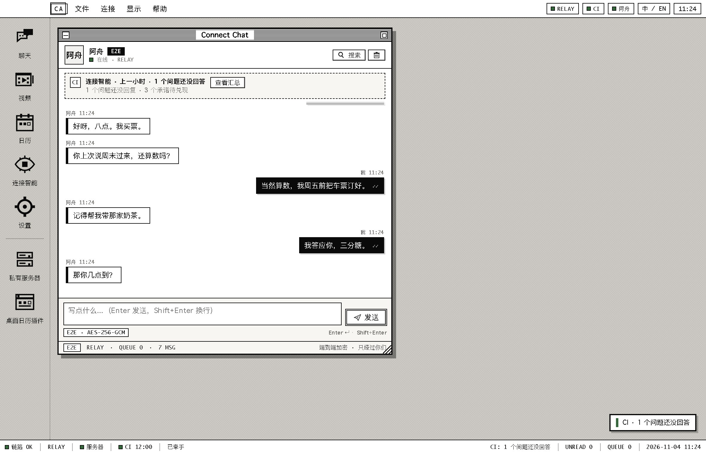
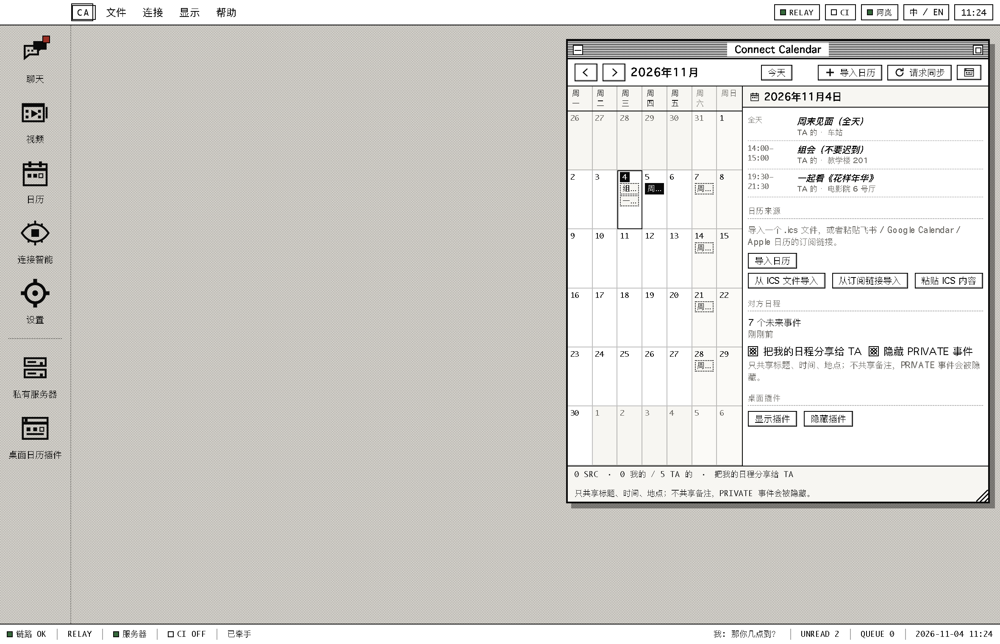
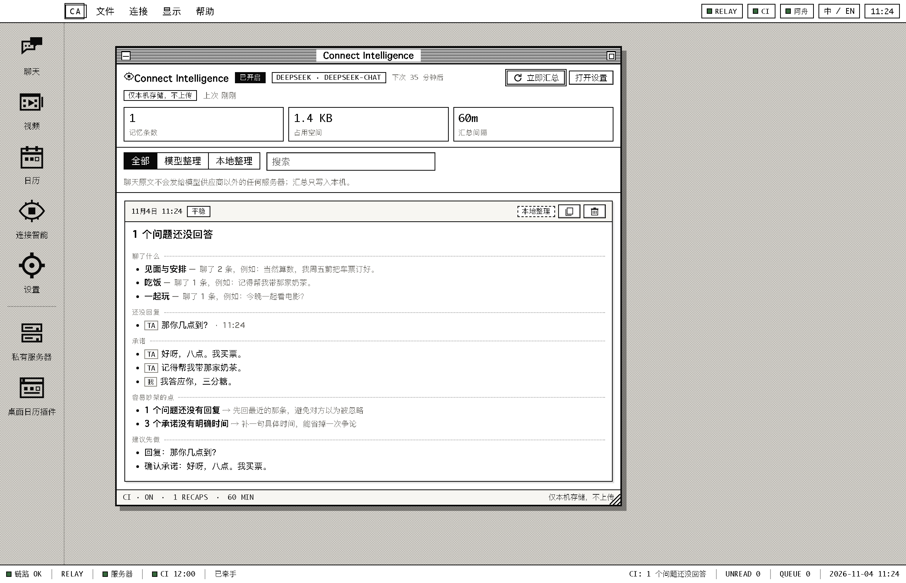
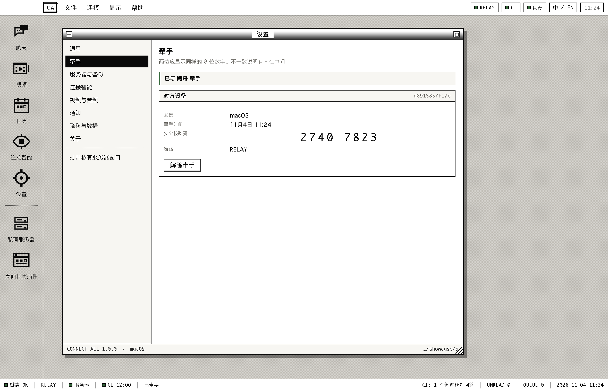
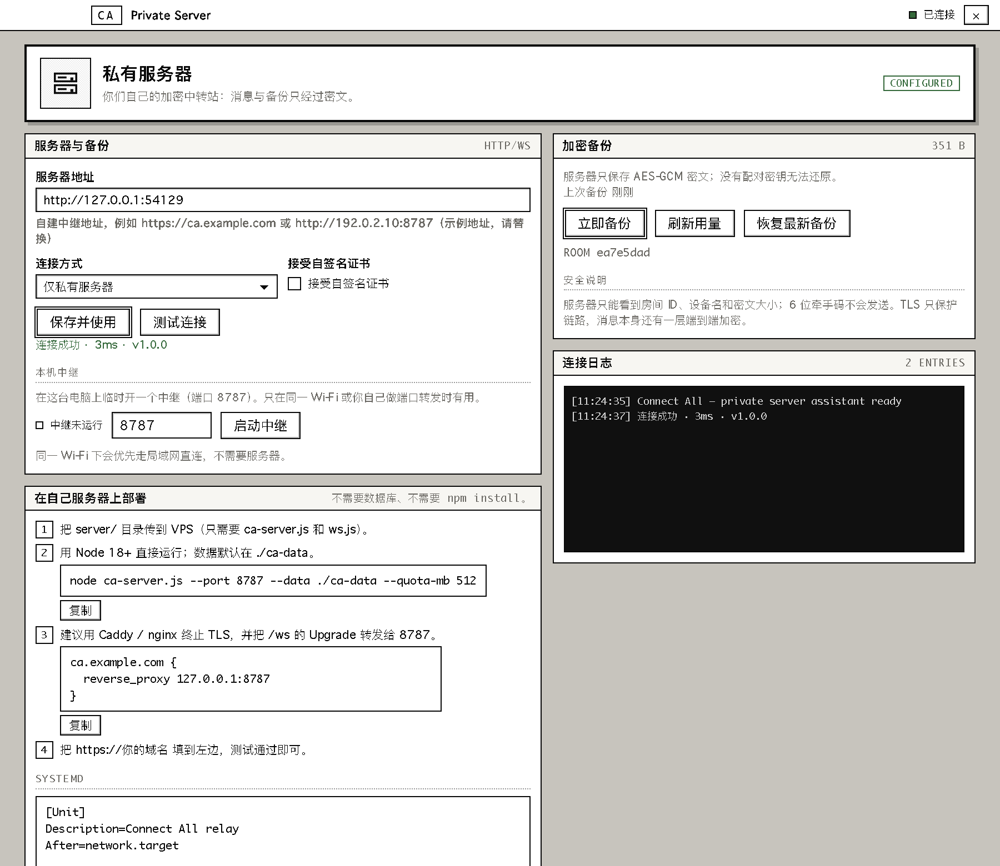
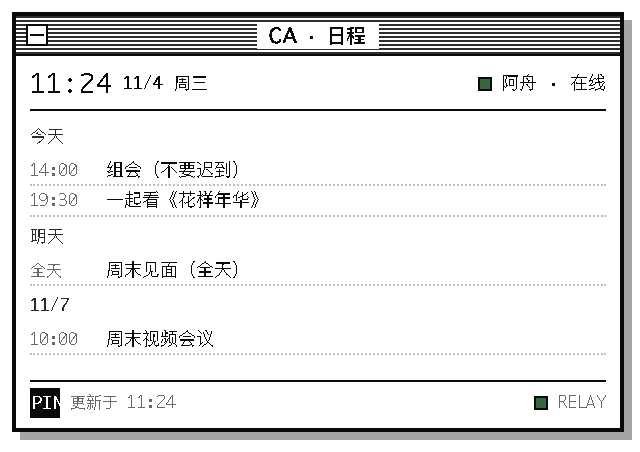
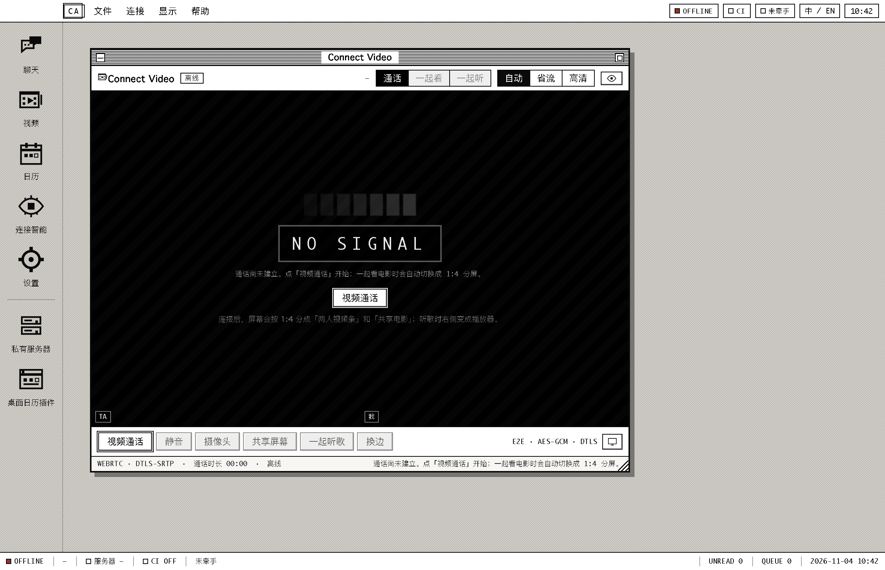

# Connect All (CA)

> 源码仓库：<https://github.com/renarddsfsdfdsfefadfsdfd/connect-all>

**异地恋的私有桌面中枢** · *A private desktop hub for long-distance couples.*

Connect All 把四件事放进同一个 1-bit 工程风桌面：

| | |
|---|---|
| **Connect Chat** | 端到端加密聊天，消息与状态只经过你们两台设备 |
| **Connect Video** | 视频通话；一起看电影时自动变成 1:4（视频条 : 共享屏幕）；一起听歌时右侧变成播放器 |
| **Connect Calendar** | 导入 ICS、双方日程互相可见、可钉在桌面的日历小插件 |
| **Connect Intelligence** | 可选开启，每小时整理一次聊天：未回复的问题 / 承诺 / 计划 / 情绪，全部只存在本机 |

> macOS · Windows · Linux 三平台。中英双语。无账号、无云端明文、无遥测。



---

## 1. 为什么是「私有」的

异地恋最怕的不是没话题，而是**忘了对方说过什么**，以及**把私密内容交给平台**。

Connect All 的取舍：

- **两台设备直接加密**。X25519 交换 + HKDF 派生，每条消息用 AES-256-GCM 单独加密。
- **服务器只当中转和保险箱**。它看到房间号、设备名、密文大小；看不到消息、日程、位置、API Key。
- **CI 记忆留在电脑上**。默认只写本机。只有你主动开启「加密备份」时，才会把密文放到自己的服务器。
- **不需要注册**。牵手码 6 位，或离线交换邀请码；服务器可以是自己的 VPS、NAS，甚至同机临时中继。

完整威胁模型见 [docs/PRIVACY.md](docs/PRIVACY.md)。

---

## 2. 界面

| 聊天 | 日历 |
|---|---|
|  |  |

| 连接智能 | 牵手 |
|---|---|
|  |  |

| 私有服务器助手 | 桌面日历插件 |
|---|---|
|  |  |

| 视频（空闲态） | |
|---|---|
|  | |

**设计语言**：Macintosh System 6/7 式的 1px 黑边、点阵底纹、条纹标题栏、硬阴影、等宽遥测；不是皮肤，而是把每个控件都按经典 Mac 的物理逻辑重画。配色只用黑、白、纸灰，加极少量状态色（绿/琥珀/红）。

---

## 3. 功能细节

### Connect Chat

- 双方各有一台设备、一条加密链路；服务器不可读。
- 消息状态：发送中 / 待发送 / 已发送 / 已送达（✓✓）。
- 离线队列：对方不在线时消息进队列，重连自动补发；服务器重建也会自动重同步（epoch 检测）。
- 输入中提示、按天分隔、未读分隔、搜索、导出 JSON、清空本机。
- 顶部固定「CI 上一小时」记忆卡：点开即可看未回复问题与承诺。

### Connect Video

- 标准视频通话：双方画面并列。
- **一起看电影**：画面按竖直方向 **1:4** 分屏；左边（可换到右边）是两人视频条，右边 4/5 是共享屏幕；分割线可拖动（15%–35%）。
- **一起听歌**：共享区变成音乐播放器（封面、1-bit 频谱、进度、播放/暂停/上一首/下一首），播放状态通过加密通道同步。
- 通过固定 4 条 m-line（摄像头 / 屏幕 / 麦克风 / 系统声）避免重协商打架；摄像头/屏幕可随时开关。
- 质量档位（自动/省流/高清）会限制发送码率；头部与底栏有 RTT、码率、FPS 遥测。
- 屏幕共享使用 Electron 的 `getDisplayMedia`；macOS 需要「屏幕录制」权限。
- 不在同一网络时，媒体仍走 WebRTC 直连；建议在服务器上跑 **coturn**（见 SERVER.md）。中继只负责信令，不转发视频。

### Connect Calendar

- 读取 `.ics`：文件、URL / webcal 订阅、粘贴文本。
- 支持 `TZID`、全天事件、`DURATION`、`RRULE`（DAILY/WEEKLY/MONTHLY/YEARLY，含 BYDAY/BYMONTHDAY/BYMONTH/COUNT/UNTIL）、`EXDATE`、`RECURRENCE-ID` 覆盖、跨 DST。
- 双方日程叠加显示：我的实线，TA 的点线；只共享标题、时间、地点、全天标记。
- `PRIVATE` 事件可隐藏；备注不共享。
- 桌面插件是无边框小窗口：今天/明天/未来 3 天、双方状态、置顶、双击打开主窗口。

### Connect Intelligence

- **默认关闭**，在「设置 → 连接智能」中开启。
- 每 60 分钟（可调 30/120/240）读取**本机**聊天窗口，输出结构化卡片：
  - 这一小时聊了什么
  - 谁问了什么还没被回答（「我想想 / 再说 / 看情况」不算回答）
  - 承诺、计划、情绪、容易吵架的点、建议先做的事
- 支持 **DeepSeek** 与 **豆包（Volcengine Ark）** 的 OpenAI 兼容接口；模型 ID 和接口地址都可自己填。
- **没有 API Key 也能用**：内置本地规则整理器，不联网，同样会抓未回复问题和承诺。
- 模型失败时自动回退到本地整理，并在卡片上标记。
- 记忆存在 `ci.jsonl`，可设 30/90/180/365 天或永久，可搜索、删除、导出。
- 双方 CI **完全独立**：各自的开关、各自的模型、各自的记忆；互相同步的是日程与状态，不是 CI 记忆。

### 私有服务器与备份

- 独立窗口（「私有服务器」）配置地址、测试连通性、启动本机中继、生成 systemd/Caddy 片段。
- 备份：聊天 + CI 记忆 → 用配对密钥 AES-GCM 加密 → 存到你的服务器。
- 服务器只保存不透明密文；按房间配额（默认 512 MB）与 10 个归档轮转。
- 恢复按 id 合并，不覆盖本机更新内容。
- 也保留本机密文副本（最近 6 份），服务器不可达时至少还有本地备份。

---

## 4. 安装与首次使用

### 安装包

- macOS：`ConnectAll-1.0.2-mac-universal.zip`（Intel + Apple Silicon 通用；解压后拖入 Applications）
  - 如需 DMG：在允许 `hdiutil` 的普通终端里跑 `pnpm dist:dmg`（本机构建沙箱不允许创建磁盘映像）
- Windows：`ConnectAll-Setup-1.0.2.exe` / `ConnectAll-Portable-1.0.2.exe`
- Linux：`ConnectAll-1.0.2-x86_64.AppImage` / `ConnectAll-1.0.2-linux-x64.tar.gz`
- 校验和：`SHA256SUMS.txt`；源码包：`ConnectAll-1.0.2-source.zip`

> 构建**未签名**（没有 Apple Developer ID / Windows 证书）。
> macOS 首次打开：右键 → 打开；若被 Gatekeeper 拦，`系统设置 → 隐私与安全性 → 仍要打开`。
> Windows SmartScreen：更多信息 → 仍要运行。

### 第一次启动

1. 打开「设置 → 通用」，把**设备名**改成对方认识的名字（默认取系统用户名），例如「阿岚的 Mac」。
2. 选择牵手方式：
   - **同一服务器**：填写自己的中继地址（或点「启动本机中继」），A 生成 6 位牵手码，B 输入同一个码；双方核对 8 位安全码后确认。
   - **离线交换**：A 生成邀请码 → 发给 B；B 接受后生成回执 → 发回 A；双方核对安全码后确认。
3. 牵手后，状态条变为 `RELAY` 或 `LAN`。
4. （可选）设置 → 连接智能：开启，选择 DeepSeek / 豆包，填 API Key，点「测试连接」。

> 同一个 Wi-Fi 下会优先走 **LAN 直连**，不需要服务器；跨网络时用私有服务器做信令，媒体仍尽量 P2P。

### 私有服务器

最快的方式：

```bash
# 在 VPS / NAS 上，Node 18+
scp -r server/ you@your-server:/opt/connect-all/
ssh you@your-server
cd /opt/connect-all/server
node ca-server.js --port 8787 --data ./ca-data --quota-mb 512
```

然后把 `http://your-server:8787` 填进「私有服务器」窗口。文档与界面里的 `192.0.2.10` 是 RFC 5737 保留的**文档示例地址**（不可路由），请换成你自己的服务器地址；它不代表任何真实设备。生产环境请用 Caddy/nginx 加 TLS（WebSocket Upgrade 要转发）。完整步骤、systemd、Caddy、coturn 见 [docs/SERVER.md](docs/SERVER.md)。

---

## 5. 数据在哪里

| 系统 | 数据目录 |
|---|---|
| macOS | `~/Library/Application Support/Connect All/` |
| Windows | `%APPDATA%\\Connect All\\` |
| Linux | `~/.config/Connect All/` |

里面：

```
config.json      设备/设置（不含密钥）
secrets.json     加密后的 API Key / 配对根密钥（系统钥匙串加密）
chat.jsonl       本机聊天记录
ci.jsonl         CI 记忆
calendar/        ICS 原文 + 对方日程快照
backups/         本机加密备份
logs/            诊断日志
```

- **API Key 和配对根密钥**：macOS 钥匙串 / Windows DPAPI / Linux libsecret（若系统无可用 keyring，会降级为明文并警告，见设置页）。
- **删除**：设置 → 隐私与数据，可清空聊天、清空 CI 记忆；服务器备份可在服务器数据目录或私有服务器窗口中管理。
- **没有遥测**，不会向任何第三方上报使用情况。

---

## 6. 从源码运行 / 构建

需要 Node 20+ 与 pnpm（仓库已带 Electron 45 的本地缓存配置）。

```bash
cd connect-all
pnpm install            # 或复用已有 node_modules
pnpm start              # 开发运行
pnpm test               # 23 项核心测试（无 Electron）
pnpm test:e2e           # 双实例真机测试：牵手/聊天/WebRTC/分屏
pnpm showcase           # 生成 docs/screenshots
pnpm dist:mac           # 通用 dmg + zip
pnpm dist:win           # NSIS + portable
pnpm dist:linux         # AppImage + tar.gz
```

**测试覆盖**：

- X25519/HKDF/AES-GCM（含篡改、错 AAD）
- 配对码归一化、房间派生
- ICS 时区 / 重复 / EXDATE / 覆盖 / 导出回环
- 聊天去重、状态、未读、保留策略、持久化
- 中继：配对房间上限、密文转发、离线回放、备份鉴权、路径穿越、重启 epoch
- CI：本地规则、假模型链路、失败回退、持久化
- 双 Session：真实牵手、聊天、日历共享、CI、备份/恢复、离线邀请
- 双 Electron：真实 IPC、WebRTC 双向视频帧、1:4 分屏同步、听歌布局、挂断

---

## 7. 诚实的限制

1. **没有 iOS / Android**：Electron 不支持 iOS；桌宠式悬浮也不符合 iOS 规则。手机端需要另做原生或 PWA。
2. **一次只能和一台设备牵手**（一夫一妻制设计）。换机/重装会生成新的配对密钥，旧的服务器备份无法解密；备份是给「同一对密钥」用的。
3. **视频跨网络可能需要 TURN**。中继只转信令；对称 NAT 下没有 coturn 会连不上。文档里给了 coturn 配置。
4. **系统声音**：macOS 13+ / Windows 支持 loopback；Linux 往往不行。听歌模式的默认方案是双方各自打开同一首本地文件并同步播放/暂停/进度。
5. **共享屏幕需要系统权限**：macOS 屏幕录制、Windows 图形捕获；未授权时只能看到 NO SIGNAL。
6. **CI 是整理器，不是心理咨询师**。它可能漏掉反讽、上下文和长期关系历史；卡片只是提醒，不代替沟通。
7. **未签名构建**：首次打开需要手动放行；自动更新未实现。
8. **服务器房间 ID 可被知道地址的人尝试**：消息仍加密；牵手码有 10 分钟 TTL 和 8 位 SAS 校验。不要把中继直接裸奔在公网，务必 TLS。
9. **本地明文**：聊天与 CI 记忆在本机是明文 JSONL（这是「记忆留在本地」的代价）。敏感设备请开全盘加密/FileVault。
10. **数据目录里的备份**是密文；但聊天记录本身不是。

---

## 8. 目录结构

```
app/
  main.js                 Electron 主进程：三窗口、托盘、权限、IPC
  preload*.js             最小上下文桥
  core/                   纯 Node 核心（可单测）
    crypto.js             配对、HKDF、AES-GCM、SAS
    identity.js           设备身份 / 对方 / 房间凭证
    pairing.js            牵手（服务器 / 离线邀请）
    link.js               传输编排 + 信封加密 + 队列
    relay-transport.js    私有服务器 WebSocket
    lan-transport.js      UDP 发现 + TCP 直连
    chat.js               本地聊天日志 / 状态 / 未读
    status.js             在线、离开、勿扰、一起看/听、在路上
    calendar-service.js   ICS 导入、共享、快照
    ics.js                手写 iCalendar 解析 + 重复展开
    llm.js                DeepSeek / 豆包 OpenAI 兼容客户端
    ci.js                 每小时整理 / 本地兜底 / 记忆
    backup.js             加密备份 / 恢复
    session.js            应用大脑
  renderer/               1-bit Macintosh UI（原生 HTML/CSS/JS）
server/
  ca-server.js            零依赖中继 + 加密备份（单文件）
  ws.js                   手写 WebSocket（客户端/服务端共用）
docs/                     设计、部署、隐私、截图
test/                     核心测试
tools/                    图标、E2E、showcase
```

---

[更新记录](CHANGELOG.md) · [最新 Release](https://github.com/renarddsfsdfdsfefadfsdfd/connect-all/releases)

## 作者

**Yaolin ZHANG**  
The Hong Kong University of Science and Technology (Guangzhou)  
Function Hub, Sustainable Energy and Environment

## 9. 许可与致谢

MIT。界面致敬经典 Macintosh；字体使用系统自带（Geneva / PingFang / 系统等宽），不分发 Apple 字体。图标为本项目 32×32 像素画生成。

---

## English in one minute

**Connect All** is a private desktop hub for long-distance couples. Chat is end-to-end encrypted; video supports a 1:4 split for watching a movie together and a synced local music player; calendars are imported from ICS and shared field-by-field; **Connect Intelligence** is an opt-in hourly local memory keeper that surfaces unanswered questions, promises, plans and mood — with DeepSeek/Doubao models or a fully offline heuristic fallback. It runs on macOS, Windows and Linux, is bilingual, and looks like a 1-bit classic Macintosh. A tiny dependency-free relay (and optional encrypted backup vault) lives in `server/`; the server only ever sees ciphertext. See [docs/DESIGN.md](docs/DESIGN.md) and [docs/PRIVACY.md](docs/PRIVACY.md).
